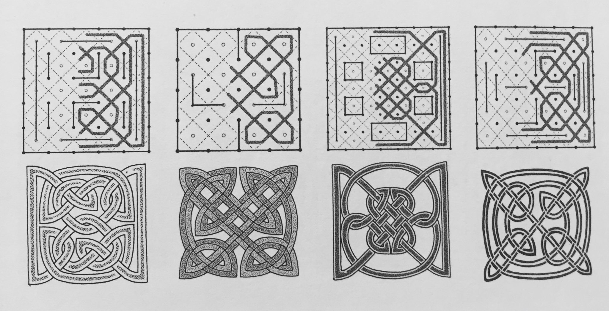

## illuminated manuscript application
* vercel next app
* illuminated manuscript application
* This will be an illuminated manuscript interactive game --reference some of the examples of character layout in the references section. It will have text and also have portals in the style of Gorogoa where you can traverse through planes by clicking on the decorated letters and marginalia. We will start by creating a builder for these individual . Let's build a generative art builder for these which will be used in the application for columns and decorated squares that will be within the text body.
* add some light overprint on a Jetbrains Mono Font or equivalent https://thinkmake.github.io/overprinter.markhurrell.com/
* use dynamic layout: https://chenglou.me/pretext/dynamic-layout/

## References: 
(see directory assets/)

https://github.com/azlen/initialis
https://illustrated-manuscript.vercel.app/

